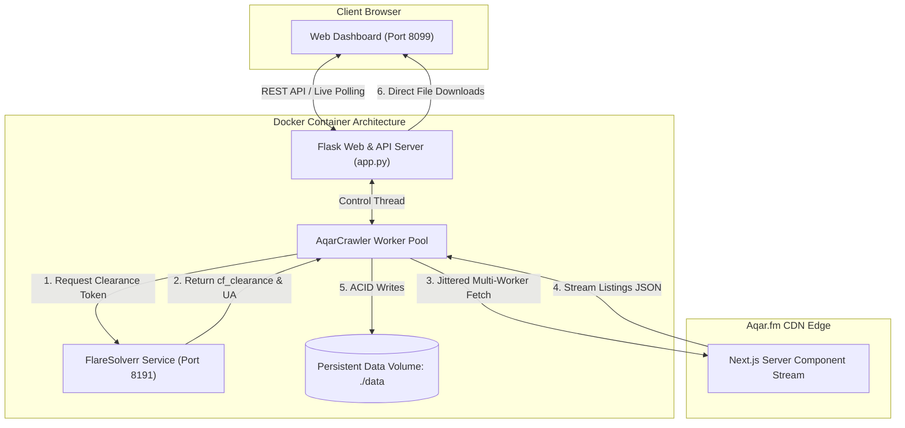
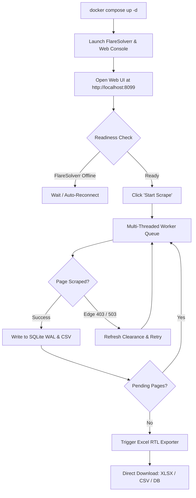

# ScrapeDatAqar 🏙️📊

> **Production-Grade, Containerized Real Estate Crawler & Web Management Console for Aqar.fm (`sa.aqar.fm`)**

[](https://github.com/iHosam/ScrapeDatAqar/releases)
[](https://www.docker.com/)
[](https://opensource.org/licenses/MIT)

ScrapeDatAqar is a full-featured real estate extraction platform with a **built-in web dashboard (Port 8099)**. It manages edge security clearances via FlareSolverr, deserializes Next.js server push streams at ~56+ ads/second, tracks state across SQLite WAL transactions, and outputs styled Arabic Right-to-Left (RTL) Excel workbooks and UTF-8 CSV datasets.

---

## 🖥️ Web Interface (Port 8099)

The web console provides complete visibility and control over the pipeline:

- **System Readiness Panel:** Real-time health monitors for FlareSolverr latency, SQLite WAL tables, and available disk storage.
- **Interactive Controls:** One-click **Start Scrape** and **Pause** actions with live process status.
- **Live Metrics Dashboard:** Completion progress bar (%), active listings counter, pending/empty page breakdown, and live file sizes.
- **Real-Time Terminal Output:** Auto-scrolling terminal streaming stdout/stderr directly from the crawler.
- **Crawl History & Artifact Downloads:** Download generated `.xlsx` (Arabic RTL), `.csv` (53 columns), and raw `.db` files directly from your browser.

---

## ⚡ Architecture Overview



---

## 🚀 Execution Pipeline



---

## 🛠️ Quick Start (Docker Deployment)

### 1. Clone & Launch Containers
```bash
git clone https://github.com/iHosam/ScrapeDatAqar.git
cd ScrapeDatAqar
docker compose up -d --build
```

### 2. Access Web Console
Open your browser and navigate to:
```text
http://<host-ip>:8099
```

---

## 📊 53-Column Schema

| # | Column Name (Arabic) | Description |
|---|----------------------|-------------|
| 1 | `رقم الإعلان` | Unique Ad ID |
| 2 | `تصنيف البحث في الرياض` | Search Category Scope |
| 3 | `القسم / الفئة` | Property Category (Villas, Apartments, Land, etc.) |
| 4 | `عنوان العقار` | Listing Title |
| 5 | `السعر (ريال)` | Property Price |
| 6 | `دورية الدفع` | Rent Frequency (Annual, Semi-Annual, Monthly) |
| 7 | `السعر الإجمالي الموثق` | REGA Total Certified Price |
| 8–9 | `المساحة (م²)` / `مساحة الصك` | Listed Area & Official Deed Area |
| 10–12 | `المدينة` / `الحي` / `العنوان` | City, District, Detailed Address |
| 13–18 | `التراخيص والصكوك` | Ad License, Deed #, Plan #, Parcel #, REGA Licensed |
| 19–22 | `بيانات المعلن` | Advertiser Name, FAL License #, Type, Phone |
| 23–27 | `مواصفات العقار` | Bedrooms, Living Rooms, Bathrooms, Floor, Age |
| 28–30 | `المواصفات الفنية` | Property Type, Street Width, Direction Facade |
| 31–39 | `المرافق والخدمات` | AC, Furnished, Car Entrance, Dual Entrances, Water, Electric, Sewage |
| 40–41 | `الإحداثيات` | Latitude & Longitude Coordinates |
| 42–46 | `الإحصائيات والتواريخ` | Views, Likes, Favorites, Creation Date, Update Date |
| 47 | `رابط صفحة البحث` | **Search page URL where the ad appeared** |
| 48–49 | `روابط الإعلان` | Direct Full Listing URL & Short Ad URL |
| 50–53 | `الوسائط والوصف` | Full Description Text, Photo Count, Photo URLs, Video URL |

---

## 📈 Real-World Benchmark

Conducted on a Raspberry Pi 5 (4-core ARM, 8GB RAM) over local network:
- **Total Ads Scraped:** 64,862 active ads
- **Total Pages Crawled:** 4,301 pages
- **Average Speed:** ~56.0 ads / second
- **Total Wall Time:** ~21.9 minutes
- **Final Excel File Size:** ~41.5 MB (RTL Arabic formatted)
- **Clearance Drop Rate:** 0% (auto-refreshed via FlareSolverr)

---

## 📄 License
This project is open-source under the MIT License.
