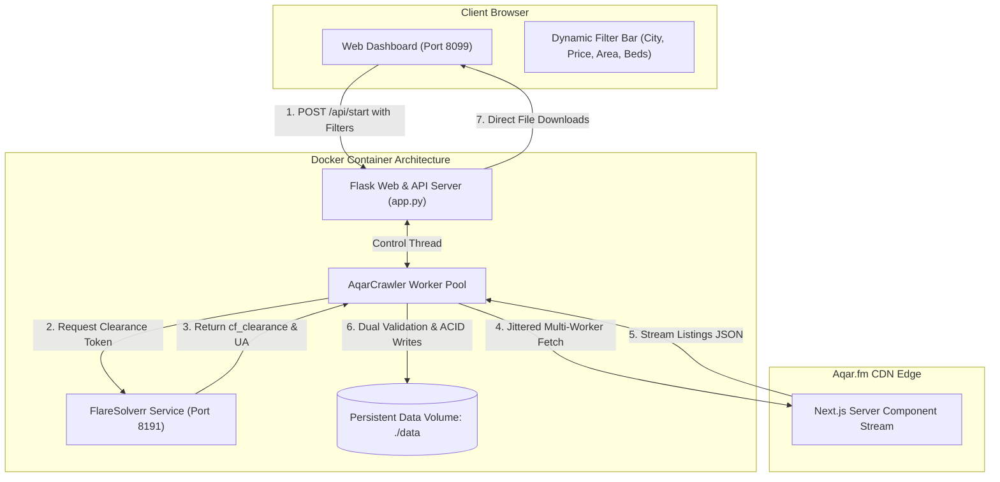

# ScrapeDatAqar 🏙️📊

> **Production-Grade, Containerized Real Estate Crawler & Web Management Console for Aqar.fm (`sa.aqar.fm`)**

[](https://github.com/iHosam/ScrapeDatAqar/releases)
[](https://www.docker.com/)
[](https://opensource.org/licenses/MIT)

ScrapeDatAqar is a full-featured real estate extraction platform with a **built-in web dashboard (Port 8099)**. It supports crawling **any city in Saudi Arabia** (Riyadh, Jeddah, Dammam, Mecca, Medina, Khobar, etc.) with granular dynamic filters for categories, price bounds, area bounds, districts, and bedroom counts.

---

## 🎛️ Dynamic Filter System (v2.0.2)

The web console introduces a powerful, multi-layered filtering engine:

| Filter | Control Type | Default Value | Optional? | Description |
|---|---|---|---|---|
| **المدينة (City)** | Multi-Option Dropdown + Custom Input | `الكل` *(الرياض افتراضياً)* | ✅ Yes | Run for Riyadh, Jeddah, Dammam, Mecca, Medina, or type any Saudi city. |
| **القسم / الفئة (Category)** | Multi-Select Dropdown | `الكل (جميع الأقسام)` | ✅ Yes | Apartments, Villas, Lands, Floors, Commercials, Warehouses, etc. |
| **السعر (Price Range)** | Dual Upper & Lower Bound Sliders | `0 - بلا حد أقصى` | ✅ Yes | Filter listings by minimum and maximum price in SAR. |
| **المساحة (Area Range)** | Dual Upper & Lower Bound Sliders | `0 - بلا حد أقصى` | ✅ Yes | Filter listings by minimum and maximum area in m². |
| **الحي (Neighborhood)** | Multi-District Text Input | `الكل (جميع الأحياء)` | ✅ Yes | Filter listings by one or more target districts. |
| **غرف النوم (Bedrooms)** | Number Field Dropdown | `الكل (أي عدد)` | ✅ Yes | 1, 2, 3, 4, 5, or 6+ bedrooms. |

> **Default Rule:** Every filter includes an **"All" (الكل)** option and is 100% optional. If left as default, the crawler captures all properties for the chosen scope.

---

## ⚡ Architecture Overview



---

## 🛠️ Quick Start (Docker Deployment)

### 1. Clone & Launch Containers
```bash
git clone https://github.com/iHosam/ScrapeDatAqar.git
cd ScrapeDatAqar
docker compose up -d --build
```

### 2. Access Web Console
Open your browser and navigate to:
```text
http://<host-ip>:8099
```

---

## 📊 53-Column Schema

| # | Column Name (Arabic) | Description |
|---|----------------------|-------------|
| 1 | `رقم الإعلان` | Unique Ad ID |
| 2 | `تصنيف البحث في المدينة` | Target City Scope (e.g. عقارات جدة, عقارات الرياض) |
| 3 | `القسم / الفئة` | Property Category (Villas, Apartments, Land, etc.) |
| 4 | `عنوان العقار` | Listing Title |
| 5 | `السعر (ريال)` | Property Price |
| 6 | `دورية الدفع` | Rent Frequency (Annual, Semi-Annual, Monthly) |
| 7 | `السعر الإجمالي الموثق` | REGA Total Certified Price |
| 8–9 | `المساحة (م²)` / `مساحة الصك` | Listed Area & Official Deed Area |
| 10–12 | `المدينة` / `الحي` / `العنوان` | City, District, Detailed Address |
| 13–18 | `التراخيص والصكوك` | Ad License, Deed #, Plan #, Parcel #, REGA Licensed |
| 19–22 | `بيانات المعلن` | Advertiser Name, FAL License #, Type, Phone |
| 23–27 | `مواصفات العقار` | Bedrooms, Living Rooms, Bathrooms, Floor, Age |
| 28–30 | `المواصفات الفنية` | Property Type, Street Width, Direction Facade |
| 31–39 | `المرافق والخدمات` | AC, Furnished, Car Entrance, Dual Entrances, Water, Electric, Sewage |
| 40–41 | `الإحداثيات` | Latitude & Longitude Coordinates |
| 42–46 | `الإحصائيات والتواريخ` | Views, Likes, Favorites, Creation Date, Update Date |
| 47 | `رابط صفحة البحث` | Search page URL where the ad appeared |
| 48–49 | `روابط الإعلان` | Direct Full Listing URL & Short Ad URL |
| 50–53 | `الوسائط والوصف` | Full Description Text, Photo Count, Photo URLs, Video URL |

---

## 📄 License
This project is open-source under the MIT License.
